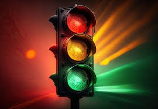

<p align="center">
  
</p>

<h1 align="center">x86 Traffic Light Controller</h1>

<h3 align="center">A four-way intersection controller written in 8086 assembly</h3>

<p align="center">
  
  
  
  
</p>

<p align="center">
  <a href="#overview"><b>Overview</b></a> ·
  <a href="#features"><b>Features</b></a> ·
  <a href="#operating-modes"><b>Modes</b></a> ·
  <a href="#controls"><b>Controls</b></a> ·
  <a href="#build--run"><b>Build</b></a> ·
  <a href="#repository-structure"><b>Structure</b></a>
</p>

---

## Overview

This project controls a four-way intersection (North-South and East-West) entirely in 8086 assembly. It sends light patterns to an output port, draws a live status screen straight into video memory, and reads the keyboard through BIOS interrupts, with no libraries and no operating-system services beyond program exit.

It was built for a Computer Organization and Assembly Language course.

| Area | Approach |
| ---- | -------- |
| Light control | 12-bit light patterns written to port 4 with `OUT` |
| Display | Direct writes to text video memory at `B800h` |
| Timing | BIOS `INT 15h` (AH=86h) microsecond delay |
| Input | BIOS `INT 16h` keyboard polling |
| Logic | State machine with four operating modes and mode memory |

## At a Glance

| | |
| --- | --- |
| **CPU target** | 8086 (small memory model) |
| **Assembler** | MASM / TASM |
| **Runs in** | DOSBox |
| **Normal cycle** | 19 seconds |
| **Operating modes** | Normal, Emergency, Rush Hour, Night |
| **Documentation** | Technical report, proposal and implementation notes in [`docs/`](./docs) |

## Features

| Feature | Description |
| ------- | ----------- |
| **Two-axis control** | Independent North-South and East-West phases with yellow warnings |
| **All-red clearance** | 5-second interval that also lets pedestrians cross from every side |
| **Live timers** | Countdown for each direction, updated every second |
| **Statistics** | Cycle counter and estimated vehicle counts per direction |
| **Pedestrian requests** | Press `P` during a green phase for 3 extra seconds |
| **Mode memory** | Leaving Emergency mode returns to the mode that was active before it |

Estimated vehicle counts use a simple model of 2 vehicles per second of green time. They are simulated figures, not measurements.

| | |
| --- | --- |
|  |  |
| <sub>Live countdown timers</sub> | <sub>Cycle and vehicle statistics</sub> |

## Signal Cycle

| Phase | Duration | North-South | East-West | Pedestrians |
| ----- | -------- | ----------- | --------- | ----------- |
| All red | 5 s | Red | Red | All sides may cross |
| NS green | 5 s | Green | Red | North-South only |
| Yellow | 2 s | Yellow | Yellow | Prepare to stop |
| EW green | 5 s | Red | Green | East-West only |
| Yellow | 2 s | Yellow | Yellow | Prepare to stop |
| **Total** | **19 s** | | | |

Both directions show yellow together between green phases. This is a simplification of real intersections, where only the direction that had green turns yellow.

## Operating Modes

| | |
| --- | --- |
|  |  |
| **Normal** · balanced 5 s / 5 s greens | **Rush Hour** · 8 s north-south, 3 s east-west |
|  |  |
| **Emergency** · all lights flash yellow, alert on screen | **Night** · all lights blink yellow |

| Mode | Key | Behaviour |
| ---- | --- | --------- |
| **Normal** | default | 19-second cycle, equal priority for both directions |
| **Rush Hour** | `R` (toggle) | Longer north-south green, shorter east-west green, 22-second cycle |
| **Emergency** | `E` | Immediate override with flashing yellow and an alert; `N` returns to the previous mode |
| **Night** | `M` | Flashing yellow on all approaches; `D` returns to day operation |

**Rush Hour trade-off.** The main road gains, the side road pays for it.

| Per hour (estimated) | Normal | Rush Hour | Change |
| -------------------- | ------ | --------- | ------ |
| North-South vehicles | ~1,895 | ~2,618 | +38% |
| East-West vehicles | ~1,895 | ~982 | −48% |
| Total | ~3,789 | ~3,600 | −5% |

Per cycle the north-south green grows from 5 s to 8 s (+60%), but the cycle also grows from 19 s to 22 s, so the hourly gain is smaller. Rush Hour trades total throughput for priority on the main road.

Rush Hour and Night modes are switched manually. There are no sensors and no scheduler.

## Controls

| Key | Function |
| --- | -------- |
| `E` | Emergency mode |
| `N` | Leave Emergency mode, return to the previous mode |
| `P` | Request 3 extra seconds for pedestrians (green phases only) |
| `R` | Toggle Rush Hour timing |
| `M` | Night mode |
| `D` | Leave Night mode |
| `ESC` | Exit the program |

Keys are not case-sensitive. The keyboard is polled between one-second ticks, so a mode change takes effect within about a second.

## Build & Run

Assemble and link with TASM or MASM, then run the executable in DOSBox:

```bat
:: TASM
tasm src\traffic_lights.asm
tlink traffic_lights.obj
traffic_lights.exe

:: MASM
masm src\traffic_lights.asm;
link traffic_lights.obj;
traffic_lights.exe
```

In DOSBox, mount the project folder first, for example `mount c C:\path\to\repo` and then `c:`.

## Repository Structure

```
x86-traffic-light-controller/
├── README.md
├── src/
│   └── traffic_lights.asm          # complete source code
├── docs/
│   ├── Technical-Report.pdf        # detailed report
│   ├── Proposal.pdf                # project proposal and specification
│   └── technical-notes.md          # signal patterns, video memory, timing, troubleshooting
└── images/                         # banner and screenshots
```

Implementation details such as the light-pattern bit layout, video memory addressing and the delay routine are in [`docs/technical-notes.md`](./docs/technical-notes.md).

## Future Enhancements

- Pedestrian countdown timers and an audible crossing signal
- Average wait time and peak-hour statistics
- Simulated vehicle detection to drive adaptive timing
- Coordination of several intersections

## License

Developed as a university course project and shared for educational reference.

## Contact

<p align="center">
  <b>Abdul Wahid</b>
</p>

<p align="center">
  <a href="mailto:a.wahid7860668@gmail.com"></a>
  <a href="https://www.linkedin.com/in/abdul-wahid022"></a>
  <a href="https://github.com/abdul-wahid022"></a>
</p>
